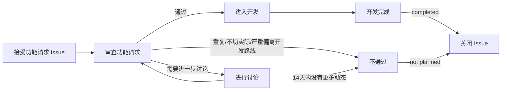

# 向背书哇（Android）贡献

感谢您向背书哇（Android）做出贡献。您可以为本项目做出包括但不限于**反馈 Bug、纠正资料内容、提出功能请求、贡献代码**等贡献。在进行贡献前，请务必阅读以下指南。

## 反馈 Bug

如果在使用背书哇的过程中遇到 Bug，可以在 [Issues](https://github.com/HelloZWH-0620/Recite-US_Android/issues/new) 中提交 Bug 反馈。

提交时请尽量包含以下信息，否则开发者可能难以诊断您遇到的问题：

- 设备型号与 Android 版本；
- 复现步骤（如果能稳定复现，请一步步描述）；
- 期望行为与实际行为；
- 相关截图或录屏。

## 纠正资料内容

背书哇内置的 60 篇文言文与古诗词的正文、注释、译文、作者信息等资料存放在 [`Beishuwa/app/src/main/assets/recite.json`](Beishuwa/app/src/main/assets/recite.json) 中，作者资料抓取自[古诗文网](https://m.guwendao.net/)。

如果您发现以下问题，欢迎提交 Issue 或直接提交 Pull Request 修正：

- 正文错漏字、分段错误、标点不规范；
- 注释或译文中的解释错误；
- 作者信息（朝代、姓名等）错误；
- 篇目分类（文言文 / 古诗词）归属错误。

**资料性纠错要求：**

- 修改正文与注释时，请给出依据（如教材版本、古诗文网等权威来源），并在 Issue 或 PR 描述中注明；
- 请保持 `recite.json` 的现有数据结构不变，仅修改字段内容；如需新增字段，请先在 Issue 中与维护者讨论；
- 修改后请确认 JSON 语法有效（可使用任意 JSON 校验工具检查）。

## 提交功能请求

如果您有关于背书哇新功能的想法，欢迎在 [Issues](https://github.com/HelloZWH-0620/Recite-US_Android/issues/new) 中提交功能请求。提交的功能请求必须满足以下要求：

- 提交的功能在当前 [v1.0.0 Beta](https://github.com/HelloZWH-0620/Recite-US_Android/releases) 版本中还没有实现；
- 没有与此功能请求重复或相似的已有 Issue；
- 提交的功能符合背书哇作为**古诗文背诵辅助应用**的开发目标，而非添加与背诵无关的内容。

提交的功能请求会按照以下流程处理：



需要注意，受限于时间和精力，**被接受的功能请求不是100%会被立即处理**，还请谅解。如果您有能力，欢迎为本项目贡献代码。

## 贡献代码

在为背书哇贡献代码之前，请务必阅读以下指南。

### 贡献准则

**您为背书哇贡献的功能须遵循以下准则：**

- **稳定：** 您贡献的功能需要能尽可能稳定工作，不破坏现有的阅读与背诵体验。
- **遵循原生体验：** 界面须使用 Android 原生组件与 Material 3 主题，遵循系统字体、深色模式与触控反馈规范。
- **如果您贡献的功能比较激进，请添加功能开关，并默认禁用此功能。** 激进的功能一般指会明显改变应用默认交互方式的功能（参考现有的【我的】->【设置】->【实验性功能】机制）。
- **能用：** 在提交补丁前，请在真机上测试您实现的功能是否能正常使用。
- 尽量不要提交仅包含文案修复的补丁。

### 补丁质量

我们接受有瑕疵的补丁，**但我们希望您在提交补丁前，您的补丁至少应该满足以下的要求：**

- 实现的功能能够工作，在提交补丁前请至少在真机或模拟器上测试一次补丁的功能是否可以正常工作；
- 我们不建议在没有人为干预的情况下完全地使用生成式人工智能实现您要贡献的功能。

如果您持续提交低质量的补丁，我们可能会限制您继续向本项目提交补丁。

### 分支与提交

本项目使用单一主分支 [`main`](https://github.com/HelloZWH-0620/Recite-US_Android/tree/main) 开发，发布版本通过 [Releases](https://github.com/HelloZWH-0620/Recite-US_Android/releases) 与标签管理。请基于 `main` 分支进行以下类型的贡献：

- 修复 Bug
- 添加新的功能
- 对代码进行重构
- 修改 README 等文档
- 资料性纠错（`recite.json`）

在本代码仓库提交时，请尽量遵守 [Conventional Commits](https://www.conventionalcommits.org/zh-hans/v1.0.0/) 规范，例如：

```text
fix: 修复作者页二级联动滑动卡顿的问题
feat: 实验性功能新增横屏开关
docs: 更新 README 致谢名单
```

### 合并更改

在进行合并之前，请先测试您贡献的代码，确保您贡献的代码能稳定运作。

您可以向本项目发起 [Pull Request](https://github.com/HelloZWH-0620/Recite-US_Android/pulls) 来合并您的更改。在发起 Pull Request 时，请简要地描述您做的更改，并最好附上您实现的功能的演示截图/视频。

## 还有疑问？

您可以加入 **QQ 交流群：950739151** 与开发者和其他用户讨论。
